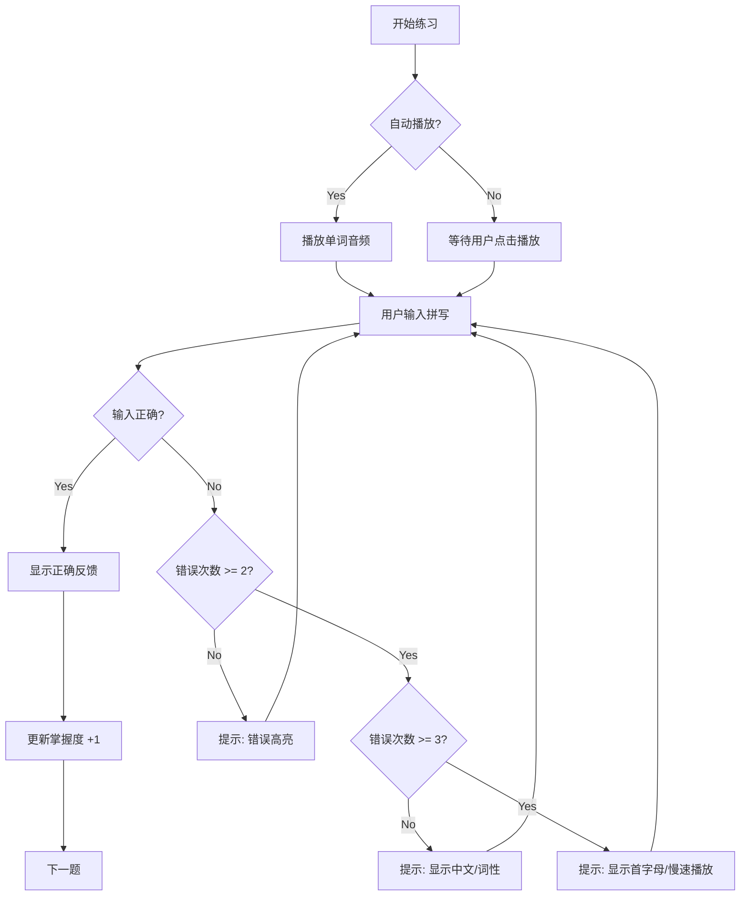
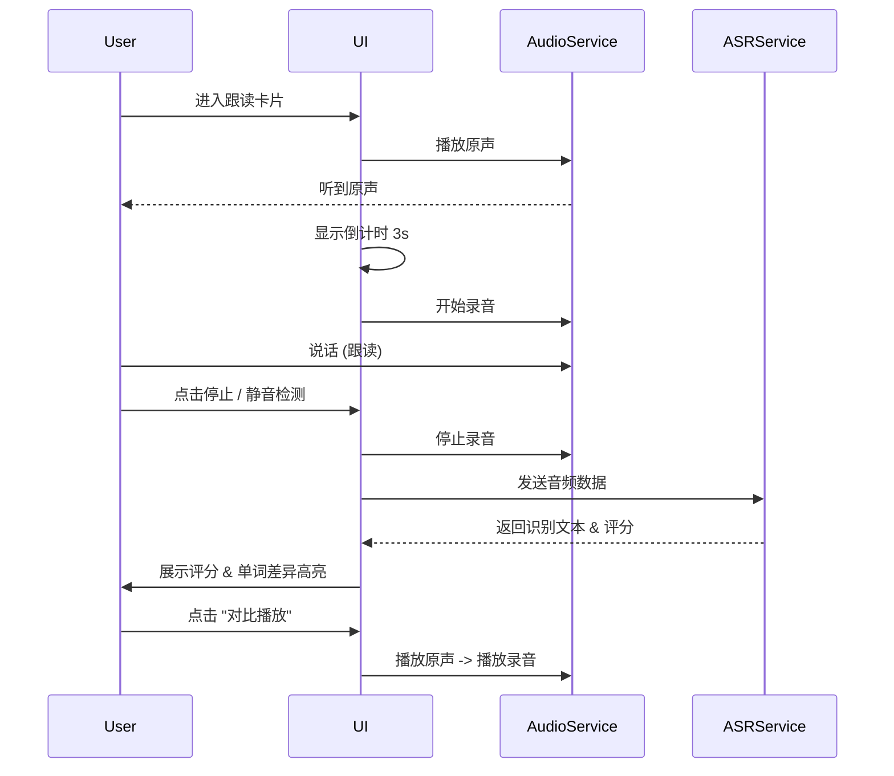
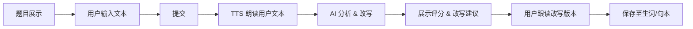

# LexiType Academy v2.0 产品设计文档

版本: 0.1.0
日期: 2025-11-23
状态: Draft
基于需求文档: `docs/english-learning-requirements-v2.md`

---

## 1. 设计概述
本设计旨在落实 v2.0 版本的“听说读写”全链路英语学习功能。核心理念是**“以练代学，以测促用”**，通过高频交互和即时反馈（AI 评分、纠错）来提升学习效率。

设计重点：
1.  **沉浸式交互**：减少菜单跳转，在一个练习卡片内完成闭环。
2.  **多模态反馈**：视觉（高亮/波形）、听觉（TTS/对比播放）、触觉（打字/点击）。
3.  **自适应难度**：根据错误率动态调整提示（Hint）层级。

---

## 2. 模块详细设计

### 2.1 词汇与听力模块 (Vocabulary & Listening)

#### 2.1.1 功能描述
结合“听音辨义”与“拼写练习”。用户先听到单词发音，尝试拼写。系统根据错误次数逐步提供提示（中文 -> 首字母 -> 完整拼写）。

#### 2.1.2 功能流程
1.  **加载单元**：系统从复习队列或新学列表加载单词。
2.  **播放音频**：自动播放单词发音（可配置次数）。
3.  **用户输入**：用户在输入框输入拼写。
4.  **实时校验**：
    *   **正确**：显示绿色反馈，播放成功音效，自动/手动进入下一词。
    *   **错误**：
        *   错误 < 阈值：震动/红色高亮，不显示正确答案。
        *   错误 >= 阈值：触发 Hint 机制，显示部分或全部答案。
5.  **结果结算**：更新掌握度，记录错误类型（拼写/听力）。

#### 2.1.3 交互流程图 (Mermaid)


#### 2.1.4 UI 界面描述
*   **顶部**：进度条（Session Progress），当前单词序号/总数。
*   **中部（核心区）**：
    *   **音频波形/图标**：点击重播。支持快捷键 `Space`。
    *   **输入框**：大号字体，居中。支持 `Type While Listen` 模式（光标跟随）。
    *   **提示区 (Hint Panel)**：默认隐藏，错误时展开。显示中文释义、例句（模糊处理）。
*   **底部**：
    *   **控制栏**：慢速播放按钮、跳过按钮、提示按钮（主动获取）。
    *   **状态栏**：显示当前连击（Streak）数。

---

### 2.2 口语跟读模块 (Speaking - Shadowing Loop)

#### 2.2.1 功能描述
用户模仿原声进行跟读，系统通过 ASR (语音识别) 进行打分，并标出漏读、错读的单词。支持“原声-录音”循环对比。

#### 2.2.2 功能流程
1.  **原声播放**：播放标准句子音频。
2.  **倒计时**：显示 3-2-1 倒计时（可选）。
3.  **录音**：自动开始录音，采集用户语音。
4.  **分析**：录音结束（静音检测或手动停止），提交 ASR 分析。
5.  **反馈**：
    *   **评分**：总分、流利度、完整度。
    *   **单词级反馈**：标红（错读）、标灰（漏读）、标绿（正确）。
6.  **循环/前进**：用户可选择“重试”或“下一句”。

#### 2.2.3 交互流程图 (Mermaid)


#### 2.2.4 UI 界面描述
*   **顶部**：原句文本（可配置是否默认隐藏，用于盲听训练）。
*   **中部**：
    *   **波形对比区**：上方为原声波形，下方为用户录音波形。
    *   **评分仪表盘**：环形进度条显示总分。
*   **底部**：
    *   **操作按钮**：巨大的“录音/停止”按钮（麦克风图标）。
    *   **辅助按钮**：原声重播、我的录音重播、下一句。

---

### 2.3 写作与表达模块 (Writing - Write Then Voice)

#### 2.3.1 功能描述
用户根据提示（中文/图片/话题）进行写作。完成后，TTS 朗读用户写的句子，AI 提供改写建议（更地道的表达），并对比朗读。

#### 2.3.2 功能流程
1.  **提示展示**：显示写作题目（例如：“描述你今天的早餐”）。
2.  **用户写作**：在文本域输入英文。
3.  **提交评估**：点击提交。
4.  **TTS 回放**：系统 TTS 朗读用户写的句子（帮助用户听出语法/语感问题）。
5.  **AI 改写**：AI 生成 1-2 个优化版本（修正语法、提升词汇）。
6.  **对比学习**：用户查看改写版本，并跟读优化后的句子。

#### 2.3.3 交互流程图 (Mermaid)


#### 2.3.4 UI 界面描述
*   **左侧/上方**：题目描述区。
*   **右侧/下方**：
    *   **输入区**：多行文本框，支持实时拼写检查（下划线）。
    *   **反馈区**（提交后出现）：
        *   **原文**：用户写的句子，错误处标红。
        *   **优化版**：AI 改写的句子，高亮升级的词汇。
        *   **播放按钮**：分别播放原文和优化版。

---

### 2.4 自适应复习模块 (Adaptive Review Carousel)

#### 2.4.1 功能描述
基于间隔重复算法（SRS），将需要复习的单词、句子混合在一个队列中。采用“卡片流”形式，快速切换。

#### 2.4.2 功能流程
1.  **队列生成**：算法拉取今日需复习的 N 个单元。
2.  **卡片展示**：
    *   **单词卡**：默认只听音，点击翻转看义。
    *   **句子卡**：挖空填词或跟读。
3.  **快速判定**：用户标记“记得/模糊/忘记”，或通过做题自动判定。
4.  **进度反馈**：显示今日复习完成度。

#### 2.4.3 UI 界面描述
*   **布局**：类似 Tinder 或 Anki 的卡片堆叠效果，或横向滑动 Carousel。
*   **卡片内容**：极简设计，突出核心内容（音频/填空）。
*   **手势**：左滑“忘记”，右滑“记得”（移动端）；快捷键 `1`, `2`, `3`（桌面端）。

---

## 3. 数据模型更新 (Data Model Updates)

为支持上述功能，需扩展现有的数据结构：

```typescript
// 扩展 Unit 类型
interface LearningUnit {
  id: string;
  type: 'word' | 'phrase' | 'sentence';
  content: string;
  audioUrl?: string;
  translation: string;
  definition?: string; // 英文释义
  tags: string[]; // e.g., 'business', 'travel', 'cefr-b1'
  masteryLevel: number; // 0-100
  nextReviewTime: number; // timestamp
  reviewHistory: ReviewRecord[];
}

// 复习记录
interface ReviewRecord {
  timestamp: number;
  result: 'correct' | 'incorrect' | 'hint_used';
  mode: 'listen' | 'speak' | 'write';
  score?: number; // 0-100 (for speaking/writing)
}
```

## 4. 总结
本设计文档定义了 LexiType Academy v2.0 的核心交互体验。开发阶段应优先实现 **Vocabulary & Listening** 和 **Speaking (Shadowing)** 两个高频场景，打通“输入-输出”闭环。
