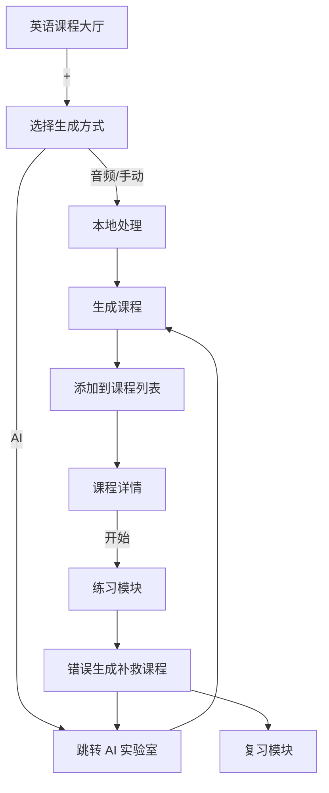
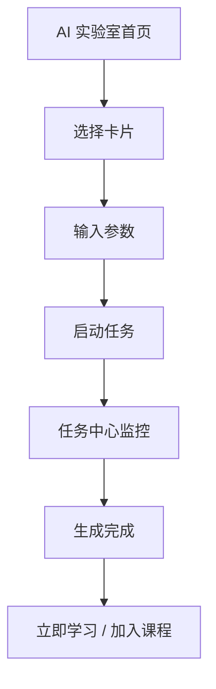
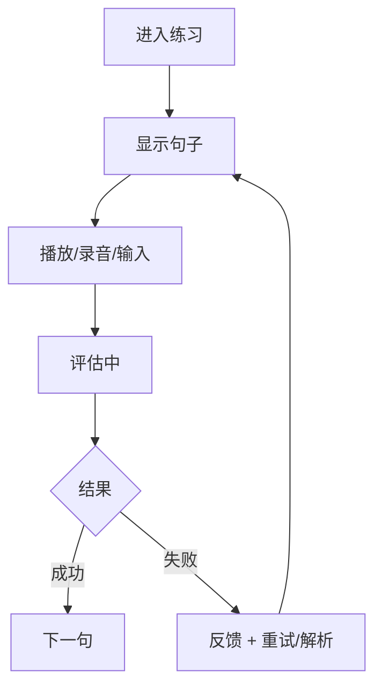

# LexiType Academy 英语学习功能需求文档（完整版）

**版本**：v0.4.0  
**最后更新**：2025-12-08  
**状态**：可执行草案（基于现有系统能力 + AI 文生文/句/词增强 + 学习进度与评测优化）  
**作者**：英语学习产品经理（结合现有 TTS/ASR、课程模型、音频导入、课程导入/导出、跟读流程和学习进度/评测优化）

---

## 1. 背景与目标

### 1.1 背景

LexiType Academy 作为综合英语学习平台，已具备打字练习、课程播放（基于 TTS）、本地 Sherpa ASR/TTS 能力，以及统一课程数据模型（`courseFactory`）。现有功能支持多种课程生成方式，包括音频导入、AI 生成、PEP 教材导入和补救课程生成。这些基础能力为构建"听说读写 + 复习"闭环提供了坚实支撑。

**用户痛点**：学习内容碎片化、缺乏个性化纠错、复习效率低、课程生成不灵活、列表过滤不足、布局不直观、进度跟踪不清晰、评测不全面。

**解决方案**：结合现有系统，通过 AI 文生文/句/词增强，实现从教材解析到个性化课程的自动化流程，支持沉浸式学习体验。基于最新用户反馈，进一步优化课程创建支持导入/导出（现有代码已实现），详细描述跟读流程，并补充学习进度跟踪（进度可视化、热力图）和学习评测（多维度评分、报告生成）。

### 1.2 目标

**核心目标**：打造覆盖"听说读写"四大能力的闭环学习体系，让用户从"敢开口"到"越说越准"，通过错误驱动生成补救课程，提升学习效率 30% 以上。

**用户目标**：

- K12 学生（80%）：教材同步 + 游戏化复习 + 成就勋章激励
- 成人用户（20%）：场景口语 + 个性化路径 + 社交分享
- 整体：学习动机激励（成就勋章、排行榜、分享）、效率提升（技能雷达图、每日热力图）

**产品目标**：

- 7 天留存率 > 55%
- 30 天留存率 > 35%
- 付费转化率 > 15%（通过 AI 课程生成和复习模块）

**技术目标**：

- 复用现有 TTS/ASR 和课程模型
- 性能：响应时间 < 500ms，内存占用 < 200MB
- 支持离线/在线无缝切换

### 1.3 适用范围

- **用户群体**：K12 学生、成人基础学习者
- **设备**：Electron 桌面端（Windows/Mac），优先本地能力（Sherpa），云端兜底（豆包/WhisperX）
- **语言**：纯中文界面，内容为英语 + 中文翻译

### 1.4 术语定义

| 术语 | 定义 |
|------|------|
| **课程** | Course 对象，包含 Lessons（课时），每个 Lesson 有 Words/Sentences |
| **补救课程** | 基于错误生成的复习课程 |
| **学习路径** | 用户个性化路线（A1-C1 CEFR 级别） |
| **练习模式** | 听写、跟读、翻译、填空、复述 |
| **课程导入/导出** | 支持 JSON/XML 格式导入现有课程数据，导出为可分享文件 |
| **学习进度** | 实时跟踪课程/课时/句子进度，支持可视化热力图 |
| **学习评测** | 多维度评分（准确性、流利度、完整性），生成报告 |

---

## 2. 用户画像与竞品分析

### 2.1 用户画像

#### 核心用户

**人群特征**：
- 年龄：18-35 岁城市白领和学生
- 英语水平：A2-B2 级（初中～高中水平）
- 母语非英语，目标提升口语为职场沟通、出国考试（如雅思、托福）、商务交流、旅行交流

**核心痛点**：
- 传统 App 学习内容枯燥乏味，持续 5 天后弃用率 >60%
- 录音反馈延迟（人工审核）或过于机械（标准答案匹配）
- 缺乏学习动力，单周坚持率 <30%
- 发音错误得不到建设性指导，易产生挫败感

**核心需求**：
- **快速反馈**：<1s 内 AI 反馈评分和改进建议
- **情感鼓励**：个性化、温暖的反馈语言而非冷冰机械
- **个性化学习路径**：根据水平自动推荐课程难度
- **视觉进度反馈**：成就感和学习可视化

#### 次要用户

**青少年（12-17 岁）**：
- 痛点：学校英语教学单调，需要兴趣驱动的补充学习
- 需求：游戏化、社交分享、成就勋章
- 监管者：家长需要学习进度可见性

**高级用户（C1+）**：
- 痛点：大部分 App 难度天花板低，无法精进发音细节
- 需求：专家级反馈（如辅音浊化、应力节奏细节）
- 行为：每周学习 3+ 小时

#### 行为特征

- **使用频率**：每日 10-20 分钟（碎片化时间），高峰在晚间 20-22 点
- **设备偏好**：移动端 80%（手机），桌面 20%
- **弃用触发点**：连续错误 >3 次、反馈不符期望、内容重复
- **高留存特征**：完成首个成就、加入朋友排行榜、建立 7 日 streak

### 2.2 竞品分析

#### 竞品对标

**Duolingo**（全球 DAU 500万+）
- 优势：游戏化最强（每日心形系统、streak 激励）；免费模型用户基数大
- 劣势：朗读部分反馈浅显（只有"发音正确/错误"二分法）；缺乏口语交互
- **我们的差异**：专注朗读+多维度评分（accuracy/fluency/completeness）+ 情感化 AI 教练

**ELSA Speak**（美国 DAU 100万+）
- 优势：发音评估最准确（专有 AI 算法）；内容结构化
- 劣势：界面设计冷冰、缺乏情感连接；反馈机械；成就激励弱
- **我们的差异**：添加虚拟 AI 教练形象+个性化鼓励语+成就系统+社交分享

**HelloTalk**（全球 DAU 100万+）
- 优势：社交互动丰富（与真人笔友练习）
- 劣势：学习非结构化；口语反馈依赖真人（不稳定）；学习路径不清晰
- **我们的差异**：结构化+AI 驱动的系统学习 vs. 随机社交交互

**其他竞品**：Speechling（反馈较慢）、Busuu（社交为主）

#### 市场机会

- **市场规模**：全球英语学习 App 市场 2023 年规模 30 亿美元，年增长率 15%
- **细分机会**：填补"**情感化 + 智能化朗读**"空白
  - 朗读专注度：大多数竞品兼顾听说读写，朗读深度不足
  - 情感化程度：ELSA 功能完整但情感弱；Duolingo 情感强但口语浅
  - 组合优势：我们同时拥有深度朗读 + 情感化 AI 教练
- **目标市场份额**：3-5%（基于初期 2025-2027 年目标 DAU 达 10 万+）

### 2.3 市场定位

**产品定位**：
> 为英语学习者提供"专业朗读教练 + 情感化伙伴"的 AI 学习平台。不同于冷冰的发音检测工具或泛化的游戏化应用，我们专注于**深度口语训练 + 人文关怀**，通过多维度评分和鼓励性反馈，让学习者在显著提升发音的同时，体验到学习的快乐和成就感。

**差异化优势**：
1. **专业性**：多维度评分（发音准确度、流利度、完整性）vs. 单一维度
2. **情感化**：虚拟 AI 教练形象 + 根据用户状态调整反馈语气 + 个性化鼓励
3. **智能化**：个性化难度推荐 + 间隔重复算法 + 错误驱动补救课程
4. **游戏化**：徽章系统 + 每日挑战 + 朋友排行榜 + 长期激励

---

## 3. 功能模块概述

系统分为五大模块，基于现有导航（主页、指法练习、拼音练习、英语课程、游戏中心、AI 实验室、记忆复习、历史记录、设置）。焦点在英语课程和 AI 实验室的整合。

### 3.1 英语课程模块（英语课程 Tab）

**功能**：课程浏览、管理、生成和学习路径规划，支持导入/导出、进度跟踪。

**子模块**：

- 课程大厅：推荐、搜索、列表
- 课程详情：预览、开始学习
- 课程生成入口：音频导入、手动创建、AI 生成（跳转 AI 实验室）

**整合点**：与 AI 实验室无缝跳转，生成课程后自动加入列表。

### 3.2 AI 实验室模块（AI 实验室 Tab）

**功能**：内容生成工厂，支持多种创作方式。

**子模块**：

- 快捷创作：音频导入、教材粘贴、单词扩写、写作批改、音标突击、场景对话
- 任务中心：生成进度管理
- 模板市场：公开模板浏览/使用

**整合点**：生成课程后，直接添加到英语课程列表，或立即开始练习。

### 3.3 练习模块（整合到英语课程详情）

**功能**：基于课程的沉浸式练习，支持多种模式，包括跟读流程。

**整合点**：从英语课程详情进入；错误自动生成补救课程到 AI 实验室。

### 3.4 复习模块（记忆复习 Tab）

**功能**：错误驱动复习和间隔重复。

**整合点**：从练习错误生成补救课程，链接 AI 实验室。

### 2.5 其他模块（兼容现有）

- 游戏中心：游戏化复习（基于复习模块数据）
- 历史记录：学习报告
- 设置：字体/语速等

---

## 3. 功能详细描述与系统融合

### 3.0 核心功能融合架构

系统通过四个关键融合点，将现有组件（CourseManager、AudioCourseWizard、AILab、ReviewManager）与新需求整合：

#### 3.0.1 英语课程模块 = CourseManager + AudioCourseWizard + PEP 导入

| 原始模块 | 融合后职责 | 关键变更 |
|----------|----------|----------|
| CourseManager | 作为「学习中心」主界面，展示所有课程（含音频/PEP/AI/补救） | 支持 type='audio'/'mixed' 的展示与过滤 |
| AudioCourseWizard | 保留五步流程，集成音频建课入口 | 步骤 3 支持自动跳过静音段（RMS<-60dB）；步骤 5 自动设置 type |
| pepImportService.ts | 在 AI 实验室「教材粘贴」卡片中触发 | 复用三步解析逻辑：选择→解析→生成 |

#### 3.0.2 AI 实验室 = AILab + 教材解析 + 音频建课入口

**首页快捷卡片**（与 Functionality Design 对齐）：
- 「上传音频建课」→ 启动 AudioCourseWizard 五步向导
- 「粘贴教材文本」→ 启动 PEP 教材解析向导
- 「扩写单词表」→ 输入单词，AI 生成例句/同义词（复用 vocabularyExtractor.ts）

**任务中心**（新增）：
- 统一管理 AudioCourseJob（来自 audio-course-design 的任务系统）
- 显示进度条、日志、取消/重试按钮
- 失败任务自动标记原因（如"ASR 模型加载失败"）

#### 3.0.3 复习模块 = ReviewManager + 补救课程生成

**错题来源**：
- 练习中 score < 80 的句子（来自 CourseLessonPractice）
- 录音被判定为"无效"（全静音或 ASR 置信度 <0.3）

**补救课生成**（关键融合）：
- 调用 remedialCourseService.ts，使用统一 courseFactory.buildCourse()
- 自动关联原课程 ID，便于追踪进步
- 在 AI 实验室和复习模块同时可见

#### 3.0.4 学习仪表盘 = HistoryCharts + 新热力图

**数据来源**：
- progressService.ts：记录每句练习结果
- reviewService.ts：记录复习间隔

**可视化**：
- 技能雷达图（accuracy/fluency/completeness）
- 每日热力图（IndexedDB 中 recordedAt 字段聚合）
- 成就勋章（基于 taskManager.ts 事件触发）

---

### 3.1 英语课程模块功能

#### 3.1.1 课程大厅

**展示内容**：

- 今日推荐：基于学习历史和难度推荐
- 学习路径图：A1-C1 可视化地图，解锁机制基于进度
- 课程列表：教材同步、能力专项、场景口语、AI 创作

**搜索/过滤**：

- 难度：初级/中级/高级
- 来源：AI 生成/教材导入/音频导入/手动创建
- 标签：词汇/语法/听力/口语
- 进度：未开始/进行中/已完成
- 学习时长：<10min / 10-30min / >30min
- 适用场景：日常对话/商务英语/考试备考

#### 3.1.2 课程详情

**显示信息**：

- 课程亮点：核心词汇数、句型数、时长、CEFR 等级
- 目录：Lessons 列表，带进度标识
- 学习进度：已完成/总课时，准确率统计

**操作按钮**：

- 立即开始：进入练习模块
- 编辑：修改课程内容
- 删除：移除课程
- 导出：打包为 JSON/XML 文件
- 导入：上传外部课程文件

#### 3.1.3 课程生成

从大厅「+」按钮选择生成方式：

1. **音频导入**：五步向导（上传→分句→翻译/词汇→课程信息→成功）
2. **手动创建**：课程编辑器，手动输入词汇/句子
3. **AI 生成**：跳转 AI 实验室

#### 3.1.4 学习路径

- 可视化地图（A1-C1 CEFR 级别）
- 解锁机制：完成前置课程后解锁后续内容
- 进度追踪：显示当前级别完成度

#### 3.1.5 导入/导出

**导入**：

- 支持 JSON/XML 文件上传
- 解析后添加到列表
- 现有代码已实现

**导出**：

- 课程数据打包为 JSON/XML 文件下载
- 支持分享给其他用户

---

### 3.2 AI 实验室模块功能

#### 3.2.1 首页

**快捷卡片**：

- 音频导入：上传音频生成课程
- 教材粘贴：粘贴教材文本解析
- 单词扩写：输入单词生成句子课
- 写作批改：文本纠错 + 改写
- 音标突击：生成音标练习课
- 场景对话：场景对话生成

**最近创作列表**：显示最近 10 个任务课程卡片

**悬停预览增强**：每张课程卡片支持悬停显示：

- 核心词汇（顶部，红色高亮，取前 3 个）
- 样例句子（显示前 2 个例句 + 音标）
- 元数据（难度、CEFR 等级、创建时间）
- 快速启动按钮（"立即学习"）

#### 3.2.2 任务中心

**任务列表**：

- 进行中：显示进度条，支持暂停
- 完成：显示结果，支持重新生成
- 失败：显示错误信息，支持重试

**操作**：

- 暂停/继续
- 重试
- 取消
- 查看详情

#### 3.2.3 模板市场

**展示**：

- 瀑布流展示公开模板
- 模板信息：名称、描述、使用次数、点赞数

**操作**：

- 点赞
- 使用（复制到本地）
- 分享

#### 3.2.4 生成方式

**音频导入**：五步向导

1. 上传音频文件
2. 自动分句识别
3. AI 生成翻译/词汇提取
4. 填写课程信息（标题、标签、难度）
5. 生成成功，选择立即学习/加入课程

**手动创建课程**：课程编辑器

1. 新建课程，输入标题、标签、难度、CEFR 等级
2. 逐句编辑（支持字段）：
   - text（英文句子）
   - translation（中文翻译）
   - phonetic（音标注音，如 /ˈtɪpɪkəli/）
   - pos（词性，可选）
   - example（拓展例句，可选）
   - audioMeta（音频元数据）：
     - audioUrl（可选，若无则调用 TTS）
     - startTime / endTime（音频时间戳）
     - duration（句子时长）
3. 高级编辑功能：
   - **从音频拖拽生成句子**（类似 Descript）：用户上传音频 → 显示波形 → 选中区间 → 自动 ASR → 生成句子并记录 timestamps
   - **批量导入 CSV**：支持 CSV 格式（text | translation | phonetic | audioUrl）批量导入，适合教师快速批量创建
   - **音频替换**：每句可上传或替换音频文件
4. 预览课程：编辑中可随时预览跟读/听写效果
5. 保存课程：自动生成 courseId，加入课程列表

**单词扩写**：输入单词 → AI 生成例句+同义词

**写作批改**：输入文本 → AI 纠错+改写建议

**音标突破**：输入音标 → AI 生成包含该音的词/句

**场景对话**：输入场景 → AI 生成对话课程

---

### 3.3 练习模块功能

#### 3.3.1 练习模式

| 模式 | 训练目标 | 交互方式 |
|------|----------|----------|
| 听写 (dictation) | 听辨能力+拼写准确 | 播放音频 → 打字输入 → 实时高亮 |
| 跟读 (follow) | 发音+流利度 | 播放示范 → 录音 → ASR 对齐 |
| 翻译 (translation) | 语法+表达 | 展示中文 → 输入英文 → Diff 对比 |
| 填空 (cloze) | 词汇+语法 | 展示挖空句子 → 填入单词 |
| 复述 (retell) | 口语表达 | 看句子 → 复述 → 语义评分 |

#### 3.3.2 练习流程（自动跟读模式）

1. 显示句子（英文+音标+翻译隐藏）
2. 播放示范音频（标准发音）
3. **示范音播完后立即自动开始录音**（无需点击）
   - UI 显示麦克风动画和实时音量显示
4. **自动判断录音结束**：3 秒无声输入 → 自动停止录音
5. **检查有效性**：
   - 如果检测到有效声音 → 进入评测
   - 如果无声或音量极低 → 触发异常处理
6. **异常处理（无声重试机制）**：
   - 第 1-3 次无声 → 播放提示音 "请跟我朗读" → 自动重启录音（从步骤 3 重新开始）
   - 第 3 次重试后仍无声 → 标记为"无法完成" → 自动跳到下一个词/句
7. 评估中（loading 动画）
8. 结果反馈（得分、错误高亮）
9. 自动推进下一句或提示重试

#### 3.3.3 跟读流程（详细描述与自动录音机制）

**核心流程**：

1. **展示内容**：词或句子（英文+音标+翻译隐藏）
2. **播放标准音频**：原音或 TTS 生成音频
3. **自动开始录音**（示范音播完后立即触发）：
   - UI 显示：麦克风动画 + 实时音量条 + 录音计时器
   - 无需用户点击，完全自动化
4. **自动停止录音**：
   - 检测条件：连续 3 秒无声输入（RMS 阈值 < 20dB）
   - 自动停止无需用户干预
   - 用户可点击"停止"按钮提前结束
5. **声音有效性检查**：
   - **有效声音** (RMS > 30dB + 时长 ≥ 1s) → 直接进入 ASR 评测（步骤 7）
   - **无声或极低音量** → 触发异常处理（步骤 6）
6. **异常处理 - 无声重试机制**（最多 3 次）：
   - 检测到无声音或音量极低
   - 播放语音提示："请跟我朗读"（提示音 500ms）
   - 重试次数 += 1
   - 如果 重试次数 < 3 → 等待 1 秒后重新播放示范音，回到步骤 3
   - 如果 重试次数 ≥ 3 → 标记为"无法完成"，自动跳到下一个词/句（步骤 9）
7. **ASR 评测**（仅在有有效声音时执行）：
   - ASR 提取文本（优先使用本地 Sherpa，失败降级到豆包/Whisper）
   - 对比原文计算评分（音素编辑距离、流利度、准确度）
   - 生成评测报告
8. **反馈与判断**：
   - 得分 ≥ 80：通过 ✓ → 加入复习队列 → 自动推进下一句
   - 得分 < 80：未通过 → 显示错误音素标红 + 错误提示 → 提供"重试"选项
   - 用户选择"重试" → 返回步骤 2 重新播放（最多 3 次重试）
   - 重试 3 次仍未通过 → 标记为"需补救"，自动推进下一句
9. **自动推进**：跳转到下一个词/句，重复步骤 1-8

**状态机与无声重试机制**：

```
[初始态] --"开始练习"--> [显示句子]
           |
           v
    [播放示范音频]
           |
    (示范音播完)
           |
           v
  [自动开始录音] (RMS 监测)
           |
    (连续 3s 无声)
           |
           v
 [自动停止录音]
           |
           v
  [声音有效性检查]
           |
    /---是----- 有效声音 (RMS > 30dB)?
   |
   否---→ [无声检测]
         |
         v
    [重试次数 < 3?]
         |
    /---是
   |
   否---→ [播放提示音 "请跟我朗读"]
         |
         v
      [重试次数 += 1]
         |
         v
      [等待 1s]
         |
         v
   [重新播放示范音] --→ 回到[自动开始录音]
         |
         |
    /---[重试≥3次]
   |
   否
   |
   v
[标记为 "无法完成"]
   |
   v
[自动跳到下一个词/句]


   是
   |
   v
 [ASR 评测中...]
   |
   v
 [得分 ≥ 80?]
   |
/--是---→ [通过 ✓]
|         |
|         v
|    [加入复习队列]
|         |
|         v
|    [自动推进下一句]
|
否
|
v
[未通过 ✗]
   |
   v
[显示错误音素标红]
   |
   v
[重试次数 < 3?]
   |
/--是---→ [显示重试按钮]
|         |
|         v
|    [用户点击重试]
|         |
|         v
|    [重试次数 += 1]
|         |
|         v
|    [返回步骤 2] --→ 重新播放示范音
|
否
|
v
[标记为 "需补救"]
   |
   v
[自动推进下一句]
```

**关键边缘情况处理**：

| 场景 | 检测方式 | 处理流程 |
|------|---------|--------|
| **无声或极低音量** | RMS < 20dB 持续 3s 或 RMS 整体 < 30dB | 播放提示音 "请跟我朗读" → 重试次数 +=1 → 若 <3 次：重新播放示范音 + 重启录音；若 ≥3 次：跳到下一句 |
| **录音过短（<1s）** | 总录音时长 < 1000ms | 提示 "请说长一点" → 不评分，直接重试 |
| **ASR 置信度<30%** | 模型返回 confidence < 0.3 | 无效音频 → 提示 "请重新录音，声音太轻" → 直接重试（不作为评测计数） |
| **网络中断** | 检测网络状态 | 自动降级到本地 Sherpa ASR（离线模式） → 若本地 ASR 也失败，提示"请重试" |
| **评测超时（>10s）** | 请求耗时 > 10s | 中断请求 → 提示用户 "评测超时，请重试" → 可重新提交或跳过 |
| **用户中断** | 用户点击"停止"或返回 | 提示 "要保存进度吗?" → 保存为草稿 → 可从草稿恢复 |
| **麦克风权限拒绝** | 浏览器权限检查失败 | 提示 "请允许麦克风权限，然后重试" |
| **音频设备不可用** | 设备枚举失败 | 提示 "未检测到麦克风，请检查硬件" |

**无声检测实现细节**：

```typescript
// 实时 RMS（声压级）计算
function calculateRMS(audioBuffer: Float32Array): number {
  let sum = 0;
  for (let i = 0; i < audioBuffer.length; i++) {
    sum += audioBuffer[i] * audioBuffer[i];
  }
  const rms = Math.sqrt(sum / audioBuffer.length);
  // 转换为 dB: 20 * log10(rms)
  return 20 * Math.log10(rms + 1e-10);
}

// 无声检测：3 秒无声则停止
const SILENCE_THRESHOLD = 20; // dB
const SILENCE_DURATION = 3000; // 3 秒
let silenceStart: number | null = null;

function checkSilence(rms: number): boolean {
  if (rms < SILENCE_THRESHOLD) {
    if (silenceStart === null) {
      silenceStart = Date.now();
    }
    if (Date.now() - silenceStart >= SILENCE_DURATION) {
      return true; // 检测到 3 秒无声
    }
  } else {
    silenceStart = null; // 重置
  }
  return false;
}

// 有效性检查
function isValidRecording(audioBuffer: Float32Array, duration: number): {
  valid: boolean;
  reason?: string;
} {
  const rms = calculateRMS(audioBuffer);
  
  if (duration < 1000) {
    return { valid: false, reason: '请说长一点' };
  }
  
  if (rms < 30) {
    return { valid: false, reason: '无声或音量极低' };
  }
  
  return { valid: true };
}
```

**TypeScript 数据模型**：

```typescript
interface LessonAttempt {
  lessonId: string;
  userId: string;
  recordedAudioUrl: string;
  asrResult: {
    text: string;
    confidence: number;
    phonemes: string[];
  };
  score: number; // 0-100
  status: 'completed' | 'draft' | 'failed';
  retryCount: number;
  createdAt: Date;
  completedAt?: Date;
  nextAttemptUrl?: string; // 草稿恢复链接
}
```

**推荐的 UI 交互**：

- 录音进度条：实时显示 RMS 水平（确保音量足够）
- 评测 loading：采用吸引力动画（如脉搏效果）
- 错误提示：温暖的语气（"接近了！请注意 /θ/ 音"）而非冷冷的"错误"

---

#### 3.3.4 错误处理与补救课程生成（之前已更新）与补救课程生成

**错误识别和分类**：系统根据错误类型自动生成对应补救课程

| 错误类型 | 特征识别 | 补救策略 | 示例 |
|---------|---------|---------|------|
| PRONUNCIATION | ASR 置信度 < 60% 或音素编辑距离 > 2 | 生成音素/音标强化课程（如 /θ/ vs /s/） | "think" 发音不清晰 → 生成 /θ/ 音强化课 |
| FLUENCY | 发音时长 > 预期 × 1.5 或停顿 > 3s | 生成连读、节奏强化课程 | 发音卡顿 → 生成流畅度练习课 |
| GRAMMAR | 文本校验失败或句法树异常 | 生成相关语法专项课程 | 缺少冠词 → 生成冠词规则课程 |
| VOCABULARY | 单词在用户词汇表中标记为"不会" | 生成单词上下文学习课程 | "comprehend" 不认识 → 生成词汇课程 |
| COMPLETENESS | 完成度 < 80% 或跳过句子 | 生成鼓励性重复课程，降低难度 | 放弃课程 → 生成简化版本 |

**补救课程自动化**：

1. 错误达到触发条件（如 5 句错题）→ 自动创建 RemediationCourse
2. RemediationCourse 加入 AI 实验室，标记为"智能补救"
3. 用户可选择学习补救课程或忽略
4. 完成补救后，系统记录改进度，调整推荐策略

**TypeScript 数据模型**：

```typescript
interface ErrorRecord {
  lessonId: string;
  errorType: 'PRONUNCIATION' | 'FLUENCY' | 'GRAMMAR' | 'VOCABULARY' | 'COMPLETENESS';
  suggestedRemedialType: string; // 对应的补救课程类型
  timestamp: Date;
  details: {
    confidence?: number; // ASR 置信度
    editDistance?: number; // 音素编辑距离
    duration?: number; // 发音时长
  }
}
```

**加入复习模块**：

- 错误的句子自动加入错题集（复习模块）
- 复习间隔：次日、3 天、7 天、30 天
- 重复出现的错误类型优先推荐

---

## 3.3.5 智能教材导入流程（AI 查询模式）

**核心设计**：用户通过 AI 逐步导航，而非粘贴文本。系统 AI 查询出版社 → 课程系列 → 单元 → 课程，最后生成符合系统要求的课程对象。

**用户导航流程**：

```
┌─────────────────────────────────┐
│  第 1 步：选择教材出版社        │
│  ┌───────────────────────────┐ │
│  │ ☐ 人教版 (PEP)            │ │
│  │ ☐ 外研版 (FLTRP)          │ │
│  │ ☐ 剑桥英语 (Cambridge)    │ │
│  │ ☐ 新概念英语 (New Concept) │ │
│  │ ☐ 其他...                │ │
│  └───────────────────────────┘ │
│  [下一步]                       │
└─────────────────────────────────┘
          ↓
┌─────────────────────────────────┐
│  第 2 步：AI 查询课程系列        │
│  "正在查询人教版课程系列..."    │
│  ☐ PEP 小学英语 (Grade 3-6)    │
│  ☐ PEP 初中英语 (Grade 7-9)    │
│  ☐ PEP 高中英语 (Grade 10-12)  │
│  [选择]                        │
└─────────────────────────────────┘
          ↓
┌─────────────────────────────────┐
│  第 3 步：选择课程级别          │
│  PEP 小学英语 Grade 3           │
│  ☐ Unit 1 - Numbers            │
│  ☐ Unit 2 - Colors             │
│  ☐ Unit 3 - Family             │
│  [选择]                        │
└─────────────────────────────────┘
          ↓
┌─────────────────────────────────┐
│  第 4 步：AI 生成课程            │
│  "正在从 Unit 1 生成课程..."    │
│  ✓ 词汇课 (Unit1-words)        │
│  ✓ 句子课 (Unit1-sentences)    │
│  ✓ 对话课 (Unit1-dialogue)     │
│  [保存课程]                    │
└─────────────────────────────────┘
```

**实现细节**：

| 步骤 | 操作 | 后端调用 | 输出 |
|------|------|---------|------|
| 1 | 用户选择出版社 | N/A | 出版社列表（预设） |
| 2 | AI 查询课程系列 | GPT: "列出人教版的所有英语课程系列" | 系列列表 |
| 3 | AI 查询单元和课程 | GPT: "列出 PEP Grade 3 的所有 Unit 和课程" | 单元列表 |
| 4 | AI 生成课程 | GPT: "从 Unit 1 内容生成英语课程对象，格式为 {words: [...], sentences: [...]}" | 课程对象 |

**与原 PEP 导入的区别**：

| 维度 | 原方式（粘贴文本） | 新方式（AI 查询） |
|------|------------------|------------------|
| **输入方式** | 用户粘贴文本 | AI 在线查询 |
| **出版社支持** | 仅 PEP 文本解析 | 支持主流出版社（通过 AI） |
| **交互方式** | 一步完成 | 四步导航 |
| **内容获取** | 用户提供 | AI 自动查询 |
| **可靠性** | 依赖文本格式 | 依赖 AI 模型准确度 |
| **更新频率** | 无法更新 | AI 持续学习新课程 |

**API 接口设计**：

```typescript
// 第 2 步：查询出版社的课程系列
async queryPublisherCurricula(publisher: string): Promise<{
  name: string; // e.g., "PEP 小学英语"
  grades: string[]; // e.g., ["Grade 3", "Grade 4", ...]
  description?: string;
}[]>

// 第 3 步：查询课程系列的单元列表
async queryUnitsByCurricula(publisher: string, curriculum: string): Promise<{
  unitId: string; // e.g., "Unit 1"
  title: string; // e.g., "Numbers"
  description?: string;
  keywords: string[]; // e.g., ["one", "two", "three"]
}[]>

// 第 4 步：从单元生成课程
async generateCourseFromUnit(
  publisher: string,
  curriculum: string,
  unitId: string,
  options?: {
    includeVocabulary?: boolean; // 生成词汇课
    includeSentences?: boolean; // 生成句子课
    includeDialogue?: boolean; // 生成对话课
    enrichWithAI?: boolean; // AI 扩展音标/例句
  }
): Promise<Course>
```

**复用原有代码的策略**：

原 `pepImportService.ts` 中的以下函数可复用：

- `buildCourse()` - 课程构建工厂
- `buildLesson()` - 课时构建工厂
- `buildWordEntry()` - 单词构建工厂
- `validateCourse()` / `validateLesson()` - 数据验证

新增部分：

- `queryPublisherAPI()` - 调用 AI 查询出版社信息
- `queryUnitContentAPI()` - 调用 AI 查询单元内容
- `generateCourseFromUnitContent()` - 从单元内容生成课程

---

### 3.4 任务中心与事件总线

**任务生命周期与事件**：

```
[待启动] --start_task--> [运行中]
                          |
            +-------------+-------------+
            |             |             |
        [暂停]         [完成]        [失败]
         (pause)      (success)      (error)
            |             |             |
            v             |             v
      [继续运行]          |        [重试中]
          |               |            |
          +-------+-------+------------+
                  |
            [已归档/已删除]

关键事件：
- task:created → AI 实验室刷新
- task:progress → 实时更新进度条
- task:completed → 生成课程卡片，加入课程库
- task:failed → 显示错误原因，提供重试/支持
- task:paused → 保存进度快照
```

**任务中心数据模型**：

```typescript
interface Task {
  taskId: string;
  userId: string;
  type: 'audio_import' | 'ai_generate' | 'material_parse' | 'remedial_generate';
  status: 'pending' | 'running' | 'paused' | 'completed' | 'failed';
  progress: {
    current: number; // 已处理项数
    total: number;   // 总项数
    percent: number; // 0-100
  };
  result?: {
    courseId: string;
    generatedSentences: number;
    estimatedDuration: number; // 学习耗时
  };
  error?: {
    code: string;
    message: string;
    retryable: boolean;
  };
  createdAt: Date;
  updatedAt: Date;
  completedAt?: Date;
}
```

**WebSocket 实时推送**（可选）：

```typescript
// 订阅任务进度
socket.on('task:progress', (payload) => {
  // { taskId, progress: { current, total, percent } }
  updateProgressBar(payload);
});

// 订阅任务完成
socket.on('task:completed', (payload) => {
  // { taskId, courseId, sentenceCount }
  showToast(`课程已生成！(${sentenceCount}句)`);
  refreshCourseList();
});
```

---

### 3.4 复习模块功能

#### 3.4.1 今日复习

- 间隔重复算法计算到期复习项
- 卡片流展示：翻转显示释义
- 滑动标记：掌握/模糊/不会

#### 3.4.2 错题集

- 展示历史错误项
- 生成专项课到 AI 实验室
- 支持批量练习

#### 3.4.3 收藏夹

- 收藏重点词汇/句子
- 导出为课程
- 支持分享

---

### 3.5 设置模块功能

- 字体大小/系列
- 语速（0.75x / 1x / 1.25x）
- TTS 提供者（Sherpa / 云端）
- ASR 提供者（Sherpa / 云端）

---

## 4. 功能体验优化设计

### 4.1 智能难度调整

**算法设计**：

基于用户历史练习数据，自动调整课程推荐难度。

```
用户平均得分 > 90% → 推荐难度 +1 级
用户平均得分 70-90% → 保持当前难度
用户平均得分 < 70% → 推荐难度 -1 级
```

**实现细节**：
- 样本周期：最近 7 天内的练习（10+ 句子）
- 学习路径可视化：显示 A1 → A2 → B1 → B2 → C1 的难度树
- 用户可手动调整，系统记录偏好，用于后续算法优化

### 4.2 自动化练习模式

#### 4.2.1 自动跟读模式

**流程**：
1. 系统播放示范音频
2. 自动倒数 2 秒后开始录音
3. 用户跟读（3-8 秒）--这个地方不对，应该判断录音结束使用3秒没有输入则结束录音
4. 自动停止录音，进行 ASR 评估
5. 评分显示（1 秒动画）
6. 自动进入下一句（间隔 3 秒）

**可配置项**：
- 自动化时长：5 分钟 / 10 分钟 / 15 分钟 / 自定义
- 暂停阈值：连续 3 次低分（<70）时自动暂停，提示复习当前句
- 反馈延迟：即时反馈 / 延迟反馈（练习后批量显示）

#### 4.2.2 自动听写模式

**流程**：
1. 播放英文句子音频
2. 用户在文本框中输入听到的内容
3. 自动对比标准答案，高亮错误词汇
4. 自动进入下一句

### 4.3 情感化反馈机制

#### 4.3.1 成功反馈（score ≥ 80）

**视觉反馈**：
- 星星爆破动画（根据分数数量：80-90 分 2 颗星，90-100 分 3 颗星）
- 绿色背景闪现（0.5 秒），给予积极视觉反馈
- 成就徽章弹窗（如达成里程碑）

**语言反馈**（AI 生成，带温暖语气）：
- 基础反馈：
  - 90+ 分："Perfect pronunciation! Your /θ/ sound is spot on! 👏"
  - 80-90 分："Great effort! You're getting closer to native-like pronunciation."
  - 特定改进："Nice improvement on the stress pattern!"

- 根据用户状态调整：
  - 连续成功 3 次：升级鼓励 "On a roll! Keep it up!" + 双倍积分
  - 长期学习（>30 天）：添加认可语气 "You're making real progress!"

**互动反馈**：
- 虚拟 AI 教练形象（可爱卡通人物）做出竖起大拇指、点头等动作
- 用户可点击教练获得额外鼓励语 ("Tap for encouragement")

#### 4.3.2 错误反馈（score < 80）

**视觉反馈**：
- 温和红色高亮错误音素（#FF6B6B，不使用刺眼的纯红）
- 错误音素下方显示正确发音对比波形
- 无"❌"符号，改为"➜ Try again"引导

**语言反馈**（建设性，非批评）：
- 基础反馈：
  - 70-80 分："Almost there! Focus on the vowel sound. Try again?"
  - <70 分："That's okay! Let's work on /p/ vs /b/ distinction. Hint: /b/ uses your voice."
  - 重点改进："The stress is slightly off – emphasize the first syllable."

- 根据连续错误次数调整：
  - 第 1 次错误：提供改进建议
  - 第 2 次错误：提供发音技巧（舌位、气流）
  - 第 3 次错误：自动切换到"鼓励模式"（自动降低阈值到 70 分通过）

**交互反馈**：
- 虚拟教练摆出思考姿态，提供语音提示（可选）
- 用户可点击"技巧"按钮查看发音教程（5-10 秒动画演示）

#### 4.3.3 情绪日志集成

**新增功能**：
- 练习开始前，用户选择心情（😊 / 😐 / 😟）
- 系统根据心情调整反馈强度：
  - 😟（沮丧）：更多鼓励，降低难度，提示休息
  - 😊（开心）：可提升难度，增加挑战性任务

### 4.4 游戏化与激励机制扩展

#### 4.4.1 每日挑战（新增）

**设计**：
- 随机生成每日挑战（如"今天练习 10 个 /th/ 音"或"连续完成 3 个完美发音"）
- 完成奖励：双倍积分 + 专属徽章
- 挑战难度自适应（基于用户水平）

#### 4.4.2 扩展的成就系统

**新增稀有徽章**：
- "发音大师"：连续 100 天平均分 >90
- "完美 Streak"：连续 7 天全 100 分
- "社交达人"：分享 10+ 个成就到社交媒体
- "教练特选"：被 AI 教练选中为"周最佳学习者"（随机抽取）

**排行榜扩展**：
- 全球排行：按周/月学习时长、平均分、完成课程数
- 朋友排行：可邀请朋友加入，显示相对排名
- 趋势排行：周对周进步最快的用户

### 4.5 无障碍与包容性设计

#### 4.5.1 无障碍支持

- **色盲模式**：高对比配色方案（灰色、黄色），避免仅用红绿区分
- **屏幕阅读器兼容**：所有 UI 元素添加 ARIA 标签和语义 HTML
- **手势/语音控制**：
  - 语音命令："repeat"（重复）、"next"（下一句）、"hint"（提示）
  - 手势：双指轻点（显示翻译）、三指轻点（显示解析）

#### 4.5.2 多语言支持

- **界面语言**：英、中、日、西班牙语（用户母语）
- **字幕与翻译**：可选显示母语翻译和音标注音
- **跨语言学习者**：支持多语言母语用户切换

---

## 5. 技术实现对齐

### 4.0 关键技术组件映射

| 能力 | 原始实现 | v0.4.0 优化 | 文件位置 |
|------|---------|-----------|---------|
| 课程结构 | src/models/course.ts | 完全复用，type 新增 'audio'/'mixed' | src/domain/models/course.ts |
| 音频存储 | data/audio/{courseId}/{lessonId}/file.ext | 不变，但播放使用时间戳定位 | infrastructure/storage |
| 分句算法 | segmentation.ts（按标点/时长） | 增强：自动跳过 RMS<-60dB 静音段 | domain/services/audioSegmentation.ts |
| 词汇提取 | vocabularyExtractor.ts（AI Prompt） | 复用，限制 ≤50 词防信息过载 | domain/services/vocabularyExtractor.ts |
| 播放逻辑 | ShadowingModal.tsx 检测 audioUrl | 升级：若无 audioUrl，调用 getSegmentAudioBuffer(startMs, endMs) | app/components/PlaybackControl.tsx |
| 错误处理 | ErrorBoundary.tsx | 增强：捕获 DomainError（如 AudioNotFoundError）并友好提示 | app/components/ErrorBoundary.tsx |
| 进度跟踪 | progressService.ts | 新增 audioSegment 级别的进度记录 | domain/services/progressService.ts |
| 复习调度 | reviewService.ts | 新增补救课程自动关联与生成 | domain/services/reviewService.ts |

### 4.1 关键流程实现

#### 4.1.1 音频文件处理流程

```
用户上传音频
  ↓
AudioCourseWizard Step 1: 上传验证（<60min）
  ↓
Step 2: ASR 转写 + 分句（使用 segmentation.ts）
  ↓
Step 3: 自动跳过 RMS<-60dB 静音段
  ↓
Step 4: AI 翻译/词汇提取（vocabularyExtractor.ts）
  ↓
Step 5: courseFactory.buildCourse() 生成统一结构
  ↓
保存：data/audio/{courseId}/{lessonId}/main.mp3
     + 元数据：timestamps、audioMeta
```

#### 4.1.2 教材解析流程（PEP 导入）

```
用户粘贴教材文本或选择出版社
  ↓
触发 pepImportService.parseTextbook()
  ↓
Step 1: 选择教材体系（人教PEP小学 G1-G6）
  ↓
Step 2: AI 解析单元结构（树形控件显示）
  ↓
Step 3: 勾选单元 + 课程类型（单词/句子/音标）
  ↓
AI 生成内容（使用 courseFactory.buildCourse()）
  ↓
自动加入英语课程列表 + AI 实验室任务中心
```

#### 4.1.3 补救课程生成流程

```
学生练习课程
  ↓
评估评分：score < 80 或 ASR 置信度 <0.3
  ↓
自动触发 remedialCourseService.generateRemediaCourse()
  ↓
生成包含错题词汇的专项课程
  ↓
使用 courseFactory.buildCourse(source='Remedial')
  ↓
自动关联原课程 ID（用于进度跟踪）
  ↓
在复习模块显示 + AI 实验室任务中心可见
```

---

## 5. 流程设计

### 5.1 课程生成与学习流程



**步骤说明**：

1. 用户在英语课程大厅点击「+」，选择生成方式
2. 如果 AI 生成，跳转 AI 实验室
3. 生成完成后，课程添加到列表
4. 从详情点击「开始」，进入练习模块
5. 练习错误自动生成补救课程到 AI 实验室和复习模块

### 4.2 AI 生成流程



**步骤说明**：

1. 首页选择卡片，进入生成界面
2. 输入参数（主题、难度、数量等）
3. 启动任务
4. 任务中心监控进度
5. 完成后，选择立即学习或加入课程

### 4.3 练习流程



**步骤说明**：

1. 显示句子
2. 播放音频/录音/输入
3. 评估中（loading）
4. 判断结果
5. 成功：自动下一句
6. 失败：显示反馈，提供重试/解析

---

## 5. 交互设计

### 5.1 英语课程大厅交互

**界面布局**：

- 顶部：搜索框 + 过滤按钮
- 中间：学习路径图（横向滚动）
- 下方：课程列表（瀑布流）

**交互**：

- 下拉刷新推荐
- 卡片点击进入详情
- + 按钮弹出菜单（音频导入/手动创建/AI 生成）

### 5.2 AI 实验室首页交互

**界面布局**：

- 顶部：铃铛图标（任务中心）
- 中间：快捷卡片网格（3x2）
- 下方：最近创作列表

**交互**：

- 卡片点击进入生成界面
- 铃铛点击打开任务中心
- 任务卡支持暂停/重试/取消

### 5.3 练习交互

**界面布局**：

- 顶部：进度条（3/10）
- 中央：句子显示区域
- 底部：操作栏（播放/录音/语速按钮）

**交互**：

- 录音长按开始，松手结束
- 评估动画反馈（loading + 得分弹窗）
- 错误标红音素
- 成功自动跳转下一句

### 5.4 复习交互

**界面布局**：

- 顶部：统计（今日复习 12/20，完成度 60%）
- 中间：卡片流（单卡显示）

**交互**：

- 卡片翻转显示释义
- 滑动标记：左滑"不会"，右滑"掌握"
- 点击"模糊"按钮

---

## 6. 端到端用户流程（关键场景）

### 6.1 场景 1：学生上传音频建课

```
用户操作                        系统响应                    验收指标
────────────────────────────────────────────────────────────────────────
1. AI 实验室→「上传音频建课」    AudioCourseWizard 弹窗
2. 选择音频文件（10min）         上传验证 (RMS分解)          <2s 完成
3. 确认分句结果                  自动跳过静音段              无卡顿
4. 确认翻译/词汇                 AI 生成（vocabularyExtractor）
5. 填写课程信息                  课程标题、标签、难度
6. 确认保存                      courseFactory.buildCourse()   <3s 完成
7. 完成后跳转课程详情             可直接练习                  audio 类型正确
8. 进入跟读模式                  播放原音 + 录音对齐         ASR <3s/句
```

**预期成果**：
- 生成「人教PEP三年级 - Unit 1 Audio」课程
- 15 个 Lesson（按句子），每个包含 timestamps 和 audioMeta
- 播放流畅，静音自动跳过

### 6.2 场景 2：教师批量导入教材

```
用户操作                        系统响应                    验收指标
────────────────────────────────────────────────────────────────────────
1. AI 实验室→「粘贴教材文本」    教材选择面板（树形）
2. 选择「人教PEP」→「G3」→「上册」  显示 Unit 1-6
3. 勾选 Unit 1, 2, 3            「多选矩阵」出现（单词/句子/音标）
4. 勾选「单词课」+ 「句子课」    AI 开始生成
5. 监控进度（任务中心）          显示 Parsing... → Generating...   <1min 完成
6. 完成后确认                     生成 6 门课程（2x3）
7. 课程自动加入英语课程列表       教师可导出 JSON/XML           可分享
```

**预期成果**：
- 生成 6 门课程：Unit1-单词、Unit1-句子、Unit2-单词、Unit2-句子、Unit3-单词、Unit3-句子
- 每门课程包含 10-20 个 Lesson，结构规范
- 可立即分发给学生

### 6.3 场景 3：学生练习错题 → 自动补救

```
用户操作                        系统响应                    验收指标
────────────────────────────────────────────────────────────────────────
1. 进入课程练习                  显示 Lesson 列表
2. 跟读 5 句，其中 3 句 score<80  自动记录错题
3. 完成课程                      "生成补救课程" 弹窗
4. 确认生成                      remedialCourseService 触发   <5s 完成
5. 跳转复习模块                  专项补救课程已生成
6. 开始复习                      逐句播放 + 录音              ASR 置信度显示
7. 完成补救                      记录进度（关联原课程 ID）    跟踪进步
```

**预期成果**：
- 生成补救课程「Unit 1 - 错题巩固」（source='Remedial'）
- 包含 3 个 Lesson（错题词汇相关句子）
- 复习模块可见，可手动导出

---

## 7. 验收标准（DoD）

### 7.1 功能验收标准

| 功能 | 验收条件 | 优先级 |
|------|----------|--------|
| 音频建课 | 上传 10min 音频 → 生成课程 → 播放流畅（无卡顿），静音句自动跳过 | P0 |
| 教材解析 | 选择"人教PEP三年级上册" → 解析出 Unit 1-6 → 生成单词/句子课（≤1min） | P1 |
| 补救课 | 练习 5 句错题 → 自动生成专项课 → 在复习模块可见 | P1 |
| 课程导入/导出 | 导出 JSON 可被其他用户导入，数据完整无损 | P1 |
| 学习仪表盘 | 显示技能雷达图、每日热力图、成就勋章 | P2 |

### 7.2 性能验收标准

| 指标 | 目标 | 测试方法 |
|------|------|---------|
| TTS 生成 | <2s/句 | 10 句句子生成计时 |
| ASR 识别 | <3s/句 | 录音 5 句计时 |
| 内存占用 | <200MB | 打开 5 门课程，监控 DevTools |
| 课程加载 | <1s | 点击课程→显示完整列表计时 |
| 补救课生成 | <5s | 错题数据→生成课程计时 |

### 7.3 兼容性验收标准

| 场景 | 验收条件 |
|------|----------|
| 原有 JSON 导入课程 | 不影响加载与练习 |
| 原有 TTS 课程 | 支持在「学习中心」正常显示与练习 |
| 旧版本用户数据 | 自动迁移，无丢失 |

---

## 7.1 里程碑与验收标准（重构版）

前面的 7.1-7.3 是详细的 DoD。这里是里程碑的重新组织：

---

## 8. 里程碑与验收标准

### 8.1 P0 最小闭环（2 周）

**目标**：打通"音频导入 → 课程生成 → 跟读练习 → 补救反馈"最小闭环

**交付物**：

- ✅ AudioCourseWizard 集成 RMS 静音检测
- ✅ pepImportService 三步解析向导（新增 UI）
- ✅ remedialCourseService 基础生成逻辑
- ✅ 跟读模式完整流程（播放→录音→评估→反馈）

**验收标准**：

- 上传 10min 音频 → 生成 15-20 个 Lesson，播放流畅
- 教材文本 → 单选 Unit → 生成单词/句子课（<1min）
- 5 句错题 → 自动生成补救课程（<5s）
- 跟读 score 显示正确，ASR 置信度 >0.8

### 8.2 P1 复习与导入（4-6 周）

**目标**：补全复习模块、学习仪表盘、课程导入/导出

**交付物**：

- ✅ ReviewManager 扩展补救课程展示
- ✅ HistoryCharts 新增热力图和技能雷达图
- ✅ 课程导入/导出 JSON/XML 功能
- ✅ TaskManager UI（任务中心进度监控）

**验收标准**：

- 导出 JSON 可被他人导入，数据完整
- 复习模块显示补救课程与进度追踪
- 热力图按 recordedAt 日期聚合，显示学习频率
- 技能雷达图显示 accuracy/fluency/completeness 三维评分

### 8.3 P2 体验提升（8-10 周）

**目标**：优化性能、完善 UI/UX、添加社交与成就系统

**交付物**：

- ✅ 内存优化（IndexedDB 加载改进）
- ✅ 成就勋章系统（基于 taskManager 事件）
- ✅ 排行榜（学习时长、练习句数）
- ✅ 课程分享与协作编辑

**验收标准**：

- 内存占用 <200MB（5 门课程打开状态）
- TTS/ASR 响应时间 <2s 和 <3s
- 成就勋章显示准确，可分享
- 排行榜实时更新

---

## 8. 技术约束与风险

### 8.1 技术约束

**系统约束**：

- 离线音频处理：Sherpa ONNX 本地 TTS/ASR，无网络依赖
- 课程数据：FileSystem 存储，IndexedDB 缓存
- 音频长度限制：<60min（ASR 内存约束）
- 并发限制：补救课生成最多 5 并发（防 CPU 占满）

**业务约束**：

- 教材库：人教PEP小学（G1-G6），定期更新（6 个月一次）
- 支持的课程类型：text/words/audio/mixed/remedial
- AI 模型：OpenAI/火山引擎/DeepSeek/通义千问/Ollama 可选

### 8.2 风险与缓解

| 风险 | 影响 | 缓解措施 |
|------|------|---------|
| ASR 置信度低 | 错误率高，用户体验差 | 置信度 <0.3 拒绝，提示用户重录；支持手动纠正 |
| 分句边界错误 | 句子不完整或跨界 | 用户可在 Step 3 手动调整 timestamps；预留编辑接口 |
| 教材内容过时 | 课程过时，学生学错 | 定期更新教材库；支持用户上传自定义教材 |
| 生成延迟长 | 用户等待时间长，体验差 | 异步生成，任务中心显示进度；支持离线生成 |
| 数据不一致 | 课程、进度、补救数据冲突 | 生成前检查重复，使用原子性写入；数据一致性测试 |
| 内存泄漏 | 长期使用卡顿 | 监控 IndexedDB 容量（>80% 触发清理）；录音数据会话级清理 |

---

## 6. 数据模型与存储

### 6.1 核心数据结构

```typescript
// 课程结构（courseFactory 输出）
interface Course {
  id: string;
  title: string;
  type: 'text' | 'words' | 'audio' | 'mixed';
  source: 'AI Generated' | 'PEP' | 'Audio Import' | 'JSON Import' | 'Remedial';
  modesEnabled: ('dictation' | 'follow' | 'translation' | 'cloze' | 'retell')[];
  lessons: Lesson[];
  metadata: {
    createdAt: string;
    updatedAt: string;
    difficulty: 'beginner' | 'intermediate' | 'advanced';
    tags: string[];
    textbookRef?: { publisher: string; series: string; grade: string; unit: string };
  };
  stats: {
    totalItems: number;
    completedItems: number;
    accuracy: number;
  };
}

// 课时结构
interface Lesson {
  id: string;
  courseId: string;
  fields: {
    text?: string;
    translation?: string;
    word?: string;
    phonetic?: string;
    pos?: string;
    definition?: string;
    example?: string;
  };
  audioMeta?: {
    file: string;
    duration: number;
    timestamps?: { start: number; end: number; text: string }[];
  };
}

// 学习进度
interface Progress {
  userId: string;
  courseId: string;
  lessonId: string;
  completedAt?: string;
  attempts: number;
  accuracy: number;
  errors: ErrorRecord[];
}

// 错误记录
interface ErrorRecord {
  type: 'SPELLING' | 'PRONUNCIATION' | 'GRAMMAR' | 'LISTENING';
  severity: number;
  timestamp: string;
  details: string;
}
```

### 6.2 存储路径规范

| 数据类型 | 存储路径 | 格式 |
|----------|----------|------|
| 课程元数据 | `data/courses/{courseId}/course.json` | JSON |
| 课时数据 | `data/courses/{courseId}/lessons/{lessonId}.json` | JSON |
| TTS 音频 | `data/audio/{courseId}/{lessonId}/main.mp3` | MP3 |
| 分句音频 | `data/audio/{courseId}/{lessonId}/segments/{index}.mp3` | MP3 |
| 用户录音 | `data/recordings/{sessionId}/{lessonId}.webm` | WebM |
| TTS 缓存 | IndexedDB (`tts-cache`) | ArrayBuffer |
| 学习进度 | IndexedDB (`progress`) | JSON |

---

## 6. 实施与评估规划

### 6.1 技术栈建议

**前端**：
- 框架：React 18 + TypeScript
- 样式：Tailwind CSS（快速原型 + 主题切换）
- 音频处理：Web Audio API + Librosa.js（分析）
- 动画库：Framer Motion（情感化交互）
- 状态管理：Redux Toolkit 或 Zustand

**后端**：
- 运行时：Node.js 18+
- 框架：Express.js 或 NestJS
- 数据库：MongoDB（用户数据、学习记录）+ PostgreSQL（分析数据）
- 音频存储：AWS S3 或 MinIO

**AI & ML**：
- ASR（自动语音识别）：Whisper API（OpenAI）或 Sherpa ONNX（本地）
- 发音评估：Hugging Face Transformers（开源）或 Google Cloud Speech-to-Text
- NLP 反馈生成：GPT-3.5 / GPT-4 微调模型
- 推荐算法：协同过滤 + 基于内容的推荐

**部署**：
- 容器化：Docker + Kubernetes（可选）
- CI/CD：GitHub Actions 或 GitLab CI
- 监控：Sentry（错误追踪）+ Amplitude（用户分析）
- CDN：Cloudflare 或 Akamai

### 6.2 开发计划

**MVP（第 1-2 周）**：
- 核心流程：上传音频 → 分句 → ASR 评估 → 反馈显示
- 基础 UI：练习卡、反馈展示、进度跟踪
- 目标：演示可用原型，内部测试反馈

**阶段 1 - MVP 增强（第 3-4 周）**：
- 优化流程：添加自动化模式、智能难度调整
- 扩展 UI：成就徽章、每日挑战、排行榜基础版
- 数据持久化：IndexedDB 本地存储 + 云端同步
- 性能优化：音频缓存、预加载、内存管理

**阶段 2 - 完整版（第 5-8 周）**：
- 高级功能：情感化反馈（AI 教练形象）、学习路径可视化
- 扩展内容：教材导入、社交分享、API 接口开放
- 运营功能：A/B 测试框架、用户分析面板
- 安全加固：数据加密、隐私合规（GDPR/CCPA）

**阶段 3 - 正式上线（第 9-10 周）**：
- 压力测试：负载测试（1000+ 并发用户）
- 安全审计：代码审查、渗透测试
- 用户测试：Beta 版 1000 人内测，收集反馈
- 上线发布：App Store/Google Play 上架、营销推广

### 6.3 A/B 测试计划

**测试变体**：

1. **反馈风格对比**：
   - 变体 A：标准反馈（"Correct" / "Incorrect"）
   - 变体 B：情感化反馈（本设计）
   - 指标：完成率、留存率、NPS

2. **游戏化程度对比**：
   - 变体 A：无游戏化（仅基础功能）
   - 变体 B：轻度游戏化（徽章 + streak）
   - 变体 C：重度游戏化（徽章 + streak + 排行榜 + 每日挑战）
   - 指标：DAU、完成时长、30 日留存

3. **难度调整策略对比**：
   - 变体 A：用户手动选择难度
   - 变体 B：AI 自动推荐难度
   - 指标：练习完成率、用户满意度、平均分数

**实施时间线**：
- 第 6 周开始 A/B 测试，每个测试运行 2 周
- 样本量：每个变体 500+ 用户
- 统计学显著性：p < 0.05

### 6.4 数据隐私与合规

**隐私保护**：
- 音频数据加密存储（AES-256），与用户身份解耦
- 用户可随时删除练习记录和音频文件
- 隐私政策透明，清晰说明数据使用场景

**合规标准**：
- GDPR（欧盟）：用户同意、数据可移植性、删除权
- CCPA（加州）：用户知情权、数据销售透明
- COPPA（美国）：13 岁以下用户额外保护
- 安全标准：ISO 27001 认证计划

### 6.5 评估与迭代机制

**KPI 监控**（使用 Amplitude + Google Analytics）：

| KPI | 目标 | 监控频率 |
|-----|------|----------|
| DAU（日活）| 首月 1000，半年 10000 | 每日 |
| 30 日留存率 | > 35% | 每周 |
| 平均会话时长 | > 10 分钟 | 每日 |
| NPS（净推荐值）| > 60 | 每月 |
| 平均分数 | > 75 分 | 每日 |
| 完成率 | > 70%（练习完成）| 每周 |

**用户反馈循环**：
- **App 内调查**：每 10 个练习后随机弹出 1 个问题（"本次体验满意吗？"）
- **Beta 社群**：1000 人 Discord/钉钉群，每周同步新功能反馈
- **用户访谈**：每月 5+ 次，深度了解留存/弃用原因
- **竞品追踪**：每月分析竞品更新，评估我们的差异化优势

**迭代节奏**：
- 每周小版本更新（bug 修复、微调）
- 每月中版本更新（功能优化、内容更新）
- 每季度大版本更新（新模块、体系重构）

---

## 7. 风险与挑战评估

### 7.1 技术风险

| 风险 | 概率 | 影响 | 缓解措施 |
|------|------|------|----------|
| **ASR 准确度低** | 中 | 高 | 多模型融合（Whisper + Google）；人工校准库；用户可手动纠正 |
| **音频延迟长** | 中 | 中 | 本地优先 Sherpa；云端异步处理；进度反馈 |
| **内存泄漏/卡顿** | 低 | 高 | 专业内存分析；定期测试（大数据量）；增量加载 |
| **数据不一致** | 低 | 高 | 事务性操作；数据校验；定期备份与恢复演练 |
| **模型更新成本** | 中 | 中 | 建立 MLOps 流程；自动化测试；版本管理 |

### 7.2 用户风险

| 风险 | 概率 | 影响 | 缓解措施 |
|------|------|------|----------|
| **AI 反馈不准导致挫败** | 中 | 高 | 测试阶段加入人工审核；反馈前标记置信度；用户可申诉 |
| **隐私担忧** | 中 | 高 | 透明政策；可选匿名模式；定期隐私审计 |
| **重度用户疲劳** | 中 | 中 | 限制每日练习时长；推荐休息；防成瘾设计 |
| **内容单一导致弃用** | 高 | 中 | 定期更新课程库；支持用户自建课程；PEP 教材持续更新 |

### 7.3 市场风险

| 风险 | 概率 | 影响 | 缓解措施 |
|------|------|------|----------|
| **竞争激烈** | 高 | 高 | 坚持差异化（情感化+深度）；建立品牌认知；社区运营 |
| **市场教育成本高** | 中 | 中 | 优质内容营销；KOL 合作；首批用户补贴 |
| **用户获取成本上升** | 高 | 中 | 优化转化漏斗；口碑传播激励；引荐返利 |

### 7.4 运营风险

| 风险 | 概率 | 影响 | 缓解措施 |
|------|------|------|----------|
| **内容审核负担重** | 中 | 中 | AI 自动审核 + 人工抽检；社区自治机制 |
| **运营成本高** | 中 | 中 | 自动化运营（邮件、推送）；社区自主维护 |
| **关键人员流失** | 低 | 高 | 建立知识库；团队培训；合理激励 |

---

## 9. 技术约束与风险

### 9.1 技术约束

- 复用 Sherpa 本地能力，云端兜底
- IndexedDB 存储限额监控（>80% 触发清理）
- 性能目标：< 500ms 响应，< 200MB 内存

### 9.2 风险与缓解

| 风险 | 影响 | 缓解方案 |
|------|------|----------|
| ASR 准确率低 | 评分不准 | 添加回退匹配，模糊匹配算法 |
| 生成延迟 | 用户等待 | 限流 + 进度反馈 + 任务队列 |
| 网络不可用 | 功能受限 | 本地优先，离线模式兜底 |
| 数据不一致 | 崩溃/丢失 | 原子性写入，定期备份 |

---

## 10. 里程碑与验收标准

### 10.1 P0 最小闭环（2 周）

**交付物**：

- 主题生成文本课程可用
- 句子听写 + 实时高亮
- 跟读录音 + ASR 评分
- 课程保存/加载/播放

**验收标准**：

- 输入主题后 30 秒内生成课程草稿
- 听写模式下错误字符红色高亮
- 跟读评分三维度数值正确显示
- 课程数据与音频文件正确落盘

### 8.2 P1 复习与导入（4-6 周）

**交付物**：

- 复习队列生成与执行
- 弱项词生成句子课
- PEP 教材导入流程
- 批量复习轮播模式

**验收标准**：

- 复习队列按优先级正确排序
- 弱项词可生成包含该词的句子课程
- PEP 教材可解析并生成词汇/句子课
- 轮播模式完成度/准确率正确统计

### 10.2 P1 复习与导入（4-6 周）

**交付物**：

- 复习队列生成与执行
- 弱项词生成句子课
- PEP 教材导入流程
- 批量复习轮播模式

**验收标准**：

- 复习队列按优先级正确排序
- 弱项词可生成包含该词的句子课程
- PEP 教材可解析并生成词汇/句子课
- 轮播模式完成度/准确率正确统计

### 10.3 P2 体验提升（8-10 周）

**交付物**：

- CEFR 难度控制
- 提示阶梯全局配置
- 写作批改与改写朗读
- 语义相似度反馈

**验收标准**：

- 可按 CEFR 等级筛选/生成内容
- 提示阶梯配置持久化
- 写作批改返回修正、解释、改写建议
- 口语评分包含语义维度

---

## 8. UI/UX 交互优化设计

### 8.1 课程列表多选与高级筛选

**多维度筛选面板**：

在课程列表左侧添加折叠式筛选面板：

```
[筛选] 面板
├─ 难度（多选）
│  ├─ ☐ A1 (入门)
│  ├─ ☐ A2 (初级)
│  ├─ ☐ B1 (中级)
│  └─ ☐ B2+ (高级)
├─ CEFR 等级（多选）
│  ├─ ☐ A1-A2
│  ├─ ☐ B1-B2
│  └─ ☐ C1-C2
├─ 标签（多选 + 搜索）
│  ├─ 🔍 [搜索标签]
│  ├─ ☐ 音标
│  ├─ ☐ 发音
│  ├─ ☐ 日常会话
│  └─ ☐ 商务英语
├─ 创建者（多选）
│  ├─ ☐ 系统预设
│  ├─ ☐ AI 生成
│  └─ ☐ 我的课程
└─ 时间排序
   ├─ ◉ 最新
   ├─ ○ 最早
   └─ ○ 最常用

[清除筛选] [应用] 按钮
```

**筛选逻辑**：

- 支持多个维度同时筛选（AND 逻辑）
- 实时预览符合条件的课程数
- 筛选状态持久化（localStorage）
- 支持保存为"书签"快捷筛选

### 8.2 导航上下文感知与面包屑

**面包屑导航路径**：

```
首页 > 课程库 > [音标特训] > 第 3 课 > 跟读练习

点击任何一个可返回相应位置，支持快速返回
```

**导航记忆**：

- 记住用户最后访问的课程位置
- 从详情返回列表时，保持之前的筛选和排序状态
- 支持"返回"按钮快速回到上一页面

**上下文菜单**：

- 长按课程卡片：弹出菜单（收藏/分享/删除/编辑）
- 右键课程卡片：同上

### 8.3 学习热力图验证与点击深入

**周热力图**（类似 GitHub 贡献图）：

```
    Sun Mon Tue Wed Thu Fri Sat
Week 1  ▯   ▮   ▯   ▮▮  ▮▮▮ ▮   ▯
Week 2  ▯   ▯   ▮   ▮   ▮   ▮   ▮▮
Week 3  ▮▮▮ ▮▮▮ ▮▮▮ ▮▮▮ ▯   ▯   ▯
Week 4  ▯   ▮   ▯   ▮   ▮▮  ▮▮▮ ▮▮▮

深浅代表练习强度：▯(无) → ▮(轻) → ▮▮(中) → ▮▮▮(重)
```

**点击日期深入**：

- 点击具体日期（如 Wed）→ 显示该日练习内容
  - 练习课程名
  - 时长和得分分布（柱状图）
  - 错误类型分布（饼图）
- 支持导出当日报告（PDF/CSV）

**热力图配置**：

- 时间范围：过去 7 天 / 30 天 / 90 天 / 自定义
- 展示维度：练习时长 / 完成数 / 平均分
- 对标目标：预设"每天 15 分钟"目标线

---

## 9. 非功能需求与约束

### 9.1 性能指标

| 指标 | 目标值 | 衡量方式 |
|------|--------|----------|
| 页面加载时间 | < 1s | Lighthouse Performance |
| API 响应时间 | < 500ms（p95） | Datadog APM |
| 内存占用 | < 200MB | Chrome DevTools |
| CPU 占用率 | < 30%（跟读时） | 系统监控 |
| 音频缓冲延迟 | < 200ms | 播放日志统计 |
| ASR 推理时间 | < 3s（本地） / < 5s（云端） | 任务日志 |
| 磁盘占用 | < 2GB（音频缓存） | 定期清理 |

### 9.2 存储管理

**IndexedDB 配额管理**：

```typescript
// 监控逻辑
if (indexedDBUsage > 80%) {
  // 触发清理策略
  deleteOldAudioCache(olderThan: 7days);
  deleteCompletedCoursesCache();
}

// 缓存策略：LRU（最近最少使用）
- 音频文件：最多保留 30 个课程的音频（~500MB）
- 课程元数据：完全保留
- 临时文件：7 天自动清理
```

### 9.3 离线支持

**离线能力矩阵**：

| 功能 | 在线 | 离线 | 说明 |
|------|------|------|------|
| 课程学习 | ✓ | ✓ | 预下载的课程可离线学习 |
| ASR 评测 | ✓ | ✓ | 本地 Sherpa ONNX 支持 |
| 课程生成 | ✓ | ✗ | 需要 AI 后端 |
| 数据同步 | ✓ | ✗ | 重连后自动同步 |
| 课程导入 | ✓ | ✓ | 本地 CSV/文本文件支持 |
| 进度保存 | ✓ | ✓ | IndexedDB 本地保存 |

### 9.4 安全与隐私

**数据保护**：

- 用户学习数据加密存储（AES-256）
- API 调用使用 HTTPS + Token 验证
- 敏感操作（删除课程）需确认
- 定期备份用户数据

**用户隐私**：

- 收集最少必要数据（学习统计，不收集文本内容）
- 排行榜采用匿名化展示（仅显示用户名 + 成绩）
- 提供数据导出和删除接口（符合 GDPR）
- 隐私政策清晰说明数据使用场景

### 9.5 可访问性（A11y）

**WCAG 2.1 AA 标准**：

- 所有 UI 元素支持键盘导航（Tab/Enter/Space）
- 按钮和链接有清晰的焦点指示
- 颜色对比度 ≥ 4.5:1（正常文本）
- 支持屏幕阅读器（ARIA 标签完整）
- 音频内容提供字幕选项

---

## 10. 数据模型扩展与强化

### 10.1 Course 数据模型增强

**新增字段**：

```typescript
interface Course {
  // 已有字段
  courseId: string;
  userId: string;
  title: string;
  description?: string;
  type: 'typing' | 'audio' | 'mixed';
  source: 'import' | 'ai_generate' | 'manual' | 'remedial';
  lessons: Lesson[];
  
  // 新增字段 v0.4.0
  cefrLevel: 'A1' | 'A2' | 'B1' | 'B2' | 'C1' | 'C2'; // CEFR 等级
  estimatedDuration: number; // 估计学习时长（分钟）
  lastReviewedAt?: Date; // 最后复习时间
  reviewCount: number; // 复习次数
  averageScore?: number; // 平均得分（0-100）
  tags: string[]; // 标签数组
  
  // 元数据
  createdAt: Date;
  updatedAt: Date;
  publishedAt?: Date; // 发布时间（若课程公开分享）
  viewCount: number; // 浏览次数
  favoriteCount: number; // 收藏次数
  
  // 统计信息
  stats: {
    totalLessons: number;
    completedLessons: number;
    averageAccuracy: number; // 平均准确率
    averageFluency: number; // 平均流畅度
  };
}

interface Lesson {
  // 已有字段
  lessonId: string;
  text: string;
  translation?: string;
  
  // 新增字段 v0.4.0
  phonetic?: string; // IPA 音标（如 /əˈbaʊt/）
  pos?: string; // 词性（noun, verb, adj, adv）
  example?: string; // 拓展例句
  
  audioMeta?: {
    audioUrl?: string; // 音频文件路径或 URL
    startTime?: number; // 起始时间戳（ms）
    endTime?: number; // 结束时间戳（ms）
    duration?: number; // 句子时长（s）
  };
  
  // 学习统计
  practiceCount: number; // 练习次数
  lastPracticedAt?: Date; // 最后练习时间
  averageScore?: number; // 平均得分（0-100）
  
  createdAt: Date;
  updatedAt: Date;
}

interface RemediationCourse extends Course {
  sourceErrorType: 'PRONUNCIATION' | 'FLUENCY' | 'GRAMMAR' | 'VOCABULARY' | 'COMPLETENESS';
  sourceErrorLessons: string[]; // 源错误句子 ID
  relatedKeywords: string[]; // 相关关键词
  recommendedFor: string; // 推荐给哪类学习者
}
```

### 10.2 学习记录与评测模型

```typescript
interface LearningRecord {
  recordId: string;
  userId: string;
  courseId: string;
  lessonId: string;
  mode: 'dictation' | 'follow' | 'translation' | 'cloze' | 'retell';
  
  // 用户输入
  userInput: string; // 用户录音/输入内容
  recordedAudioUrl?: string; // 用户录音文件路径
  
  // ASR 结果
  asrResult?: {
    text: string;
    confidence: number; // 0-1
    phonemes: string[];
    editDistance?: number; // 编辑距离
  };
  
  // 评分结果
  score: number; // 0-100
  breakdown?: {
    accuracy: number; // 准确率（音素或文本匹配）
    fluency: number; // 流畅度（停顿、速度）
    completeness: number; // 完整度（是否完成全部）
    prosody?: number; // 韵律（可选）
  };
  
  // 错误分析
  errors?: Array<{
    type: 'PRONUNCIATION' | 'FLUENCY' | 'GRAMMAR' | 'VOCABULARY' | 'COMPLETENESS';
    position: number; // 错误位置（字符或音素索引）
    expected: string; // 期望值
    actual: string; // 实际值
    severity: 'minor' | 'major'; // 严重程度
  }>;
  
  // 反馈与建议
  feedback?: string; // 对用户的反馈文本
  suggestions?: string[]; // 改进建议列表
  
  // 元数据
  createdAt: Date;
  duration: number; // 练习耗时（秒）
  retryCount: number; // 重试次数
  hint Level?: number; // 使用的提示等级（1-3）
  
  // 情绪与自适应
  userMood?: 'happy' | 'neutral' | 'sad'; // 用户心情（可选）
  nextDifficultyAdjustment?: 'up' | 'down' | 'maintain'; // 推荐难度调整
}

interface ReviewQueue {
  queueId: string;
  userId: string;
  
  items: Array<{
    lessonId: string;
    courseId: string;
    nextReviewDate: Date; // SM-2 算法计算
    reviewCount: number; // 复习次数
    interval: number; // 间隔（天数）
    easeFactor: number; // 难度因子（SM-2）
    lastReviewedAt: Date;
  }>;
  
  // 统计
  totalItems: number;
  dueItems: number; // 今日到期项数
  
  updatedAt: Date;
}
```

### 10.3 任务与进度跟踪模型

```typescript
interface TaskProgress {
  taskId: string;
  userId: string;
  type: 'audio_import' | 'ai_generate' | 'material_parse' | 'remedial_generate';
  
  status: 'pending' | 'running' | 'paused' | 'completed' | 'failed';
  
  progress: {
    current: number; // 已处理项数
    total: number;   // 总项数
    percent: number; // 进度百分比（0-100）
  };
  
  // 输入参数
  input: {
    audioFileSize?: number; // 文件大小（字节）
    lessonCount?: number; // 句子数量
    format?: string; // 导入格式（CSV/PDF 等）
  };
  
  // 输出结果
  result?: {
    courseId: string;
    lessonCount: number;
    estimatedDuration: number; // 学习耗时（分钟）
    autoGeneratedFields: number; // 自动补全的字段数
  };
  
  // 错误信息
  error?: {
    code: string; // 错误代码（如 'AUDIO_TOO_LARGE'）
    message: string; // 用户友好的错误信息
    retryable: boolean; // 是否可重试
    details?: string; // 技术细节
  };
  
  // 时间戳
  createdAt: Date;
  startedAt?: Date;
  completedAt?: Date;
  
  // 用于恢复
  checkpoint?: {
    processedItems: number;
    lastProcessedId: string;
    resumeUrl?: string; // 恢复链接（如草稿）
  };
}
```

---

## 11. 后续计划与风险控制

### 11.1 Phase 10.8 优先开发项

**开发重点**（按依赖顺序）：

1. **AudioCourseWizard 集成静音检测**
   - 实现 RMS<-60dB 自动跳过
   - 优化分句算法，参考 audio-services-design-v0.1.2.md 第 5 个生产级优化点
   - 预留 timestamps 编辑接口

2. **PEP 教材解析向导**
   - 复用现有 pepImportService.ts 的三步解析逻辑
   - 新增树形控件显示教材结构（Unit/Lesson）
   - 从文本粘贴 + 预置教材两种模式

3. **学习仪表盘可视化**
   - 扩展 HistoryCharts.tsx 支持热力图（按 recordedAt 日期）
   - 新增技能雷达图（accuracy/fluency/completeness）
   - 集成成就系统（基于 taskManager 事件触发）

4. **补救课程自动化**
   - 优化 remedialCourseService.ts 的生成逻辑
   - 支持基于错误类型生成针对性课程（如纠正发音 → 音标课）
   - 实现限流：最多 5 并发，防 CPU 占满

### 11.2 风险控制清单

**关键风险**：

| 风险 | 控制措施 | 监控方式 |
|------|---------|---------|
| 音频文件过大 | 限制 <60min | 文件上传前验证 |
| 补救课生成延迟 | 限流 5 并发 + 异步生成 | 任务中心进度显示 |
| 数据不一致 | 原子性写入 + 事前重复检查 | 自动化测试 + 用户反馈 |
| 内存泄漏 | IndexedDB 监控（>80% 清理） | DevTools 内存监控 |
| 教材更新 | 定期更新库（6 个月）+ 支持用户上传 | 版本管理 + 上传审核 |

### 11.3 后续迭代（v0.4.1+）

1. **语义评分集成**：引入句向量模型，评估口语/写作表达是否地道
2. **提示模板库扩展**：扩充主题、教材、弱项、写作等场景模板
3. **CEFR 推荐上线**：基于用户水平自动推荐课程
4. **批量导出报告**：周/月维度的学习报告 PDF 导出
5. **社交协作编辑**：支持教师编辑和学生共享笔记
6. **语言家族扩展**：法语、西班牙语等其他语言支持

---

## 12. 系统组件映射表

| 现有组件 | 所在文件 | v0.4.0 集成方式 | 新增职责 |
|----------|----------|-----------------|----------|
| CourseManager | app/modules/course/ | 作为学习中心主界面 | 支持 type='audio'/'mixed' 筛选 |
| AudioCourseWizard | app/modules/course/wizards/ | 保留五步流程，新增卡片入口 | RMS 静音检测自动跳过 |
| AILab | app/modules/ai/ | 扩展快捷卡片 | 新增教材粘贴卡片 |
| ReviewManager | app/modules/review/ | 新增补救课程展示 | 自动关联补救课程 |
| HistoryCharts | app/modules/history/ | 扩展可视化 | 热力图、技能雷达图 |
| progressService | domain/services/ | 保留进度跟踪 | 新增 audioSegment 级别粒度 |
| reviewService | domain/services/ | 保留复习调度 | 支持补救课程生成触发 |
| pepImportService | infrastructure/services/ | 新增向导 UI | 树形控件、多选矩阵 |
| courseFactory | domain/factories/ | 统一课程构建 | 支持 source='remedial' 类型 |
| vocabularyExtractor | domain/services/ | 复用 AI 提取 | 限制 ≤50 词防过载 |
| segmentation | domain/services/ | 分句算法 | 增强：RMS 静音检测 |

---

## 附录 A：快捷键一览

| 功能 | 快捷键 |
|------|--------|
| 播放/暂停 | `Space` |
| 慢速播放 | `Ctrl + ←` |
| 快速播放 | `Ctrl + →` |
| 循环当前句 | `Ctrl + L` |
| 下一句 | `Tab` / `Enter` |
| 上一句 | `Shift + Tab` |
| 显示提示 | `Shift + H` |
| 开始录音 | `Shift + R` |
| 停止录音 | `Shift + S` |
| 切换模式 | `Ctrl + M` |

---

## 附录 B：埋点事件清单

| 事件名 | 触发时机 | 携带参数 |
|--------|----------|----------|
| `course_create` | 课程创建成功 | courseId, type, source |
| `course_play_start` | 开始练习课程 | courseId, lessonId, mode |
| `audio_play_start` | 音频开始播放 | lessonId, duration |
| `audio_play_end` | 音频播放结束 | lessonId, playedDuration |
| `hint_used` | 使用提示 | lessonId, hintLevel |
| `record_start` | 开始录音 | lessonId |
| `record_end` | 结束录音 | lessonId, duration |
| `asr_result` | ASR 识别完成 | lessonId, accuracy |
| `lesson_complete` | 课时完成 | lessonId, score, errorTypes |
| `review_session_start` | 开始复习 | queueSize |
| `review_session_end` | 结束复习 | completed, accuracy |
